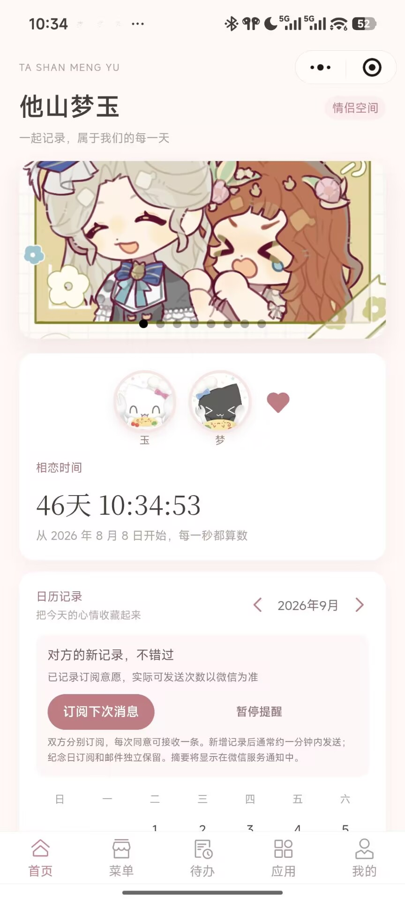
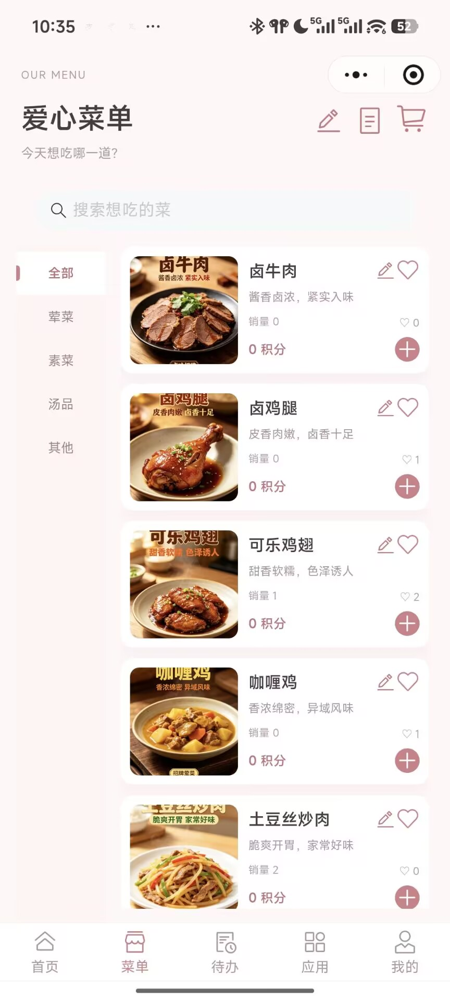
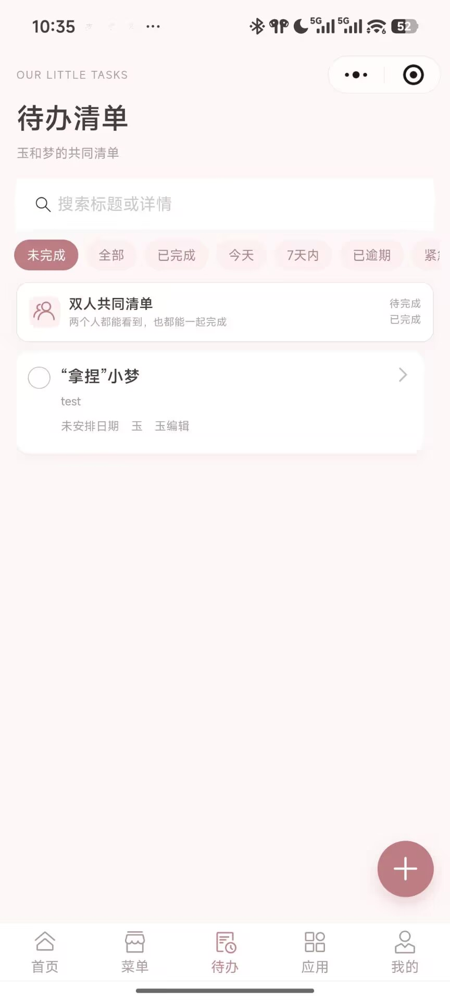
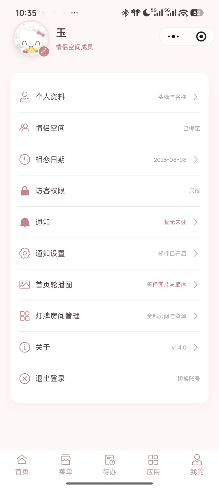
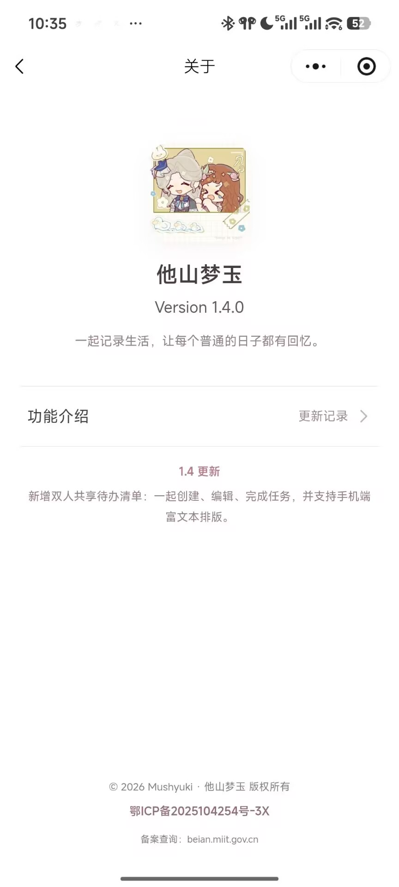
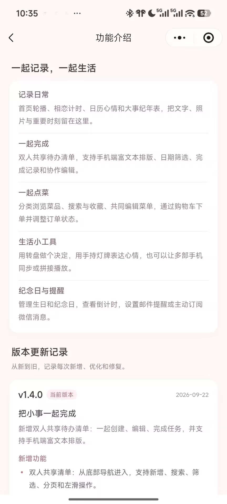

# Couple Space Mini Program

[中文](README.md) · [Deployment (Chinese)](docs/deployment.zh-CN.md) · [Architecture](docs/architecture.md) · [Security](SECURITY.md)

A self-hosted WeChat Mini Program for two people to record everyday life, plan shared work, order meals, remember anniversaries, exchange questions, and use small interactive tools in one private space.

> This repository is a sanitized, reusable edition extracted from a deployed personal project. Production domains, WeChat credentials, template IDs, email authorization codes, personal names, private dates, and server settings have been removed. Screenshots show a customized instance; the public template uses placeholders.

## Screenshots

| Home and calendar | Menu and orders | Shared todos |
| --- | --- | --- |
|  |  |  |

| Profile | About | Features and releases |
| --- | --- | --- |
|  |  |  |

## Features

- Shared home, relationship timer, calendar, moods, text, images, links, editor attribution, and visitor read-only mode.
- Collaborative menu, categories, search, favorites, cart, orders, status changes, and order history.
- Two-person todo list with rich text, filters, priorities, assignees, deadlines, up to nine images, completion history, and WeChat sharing.
- Vertical life timeline with text, images, links, small videos, and one-piece long-image export.
- Solar/lunar anniversaries, elapsed/next-occurrence counters, in-app notifications, optional SMTP email, and one-time WeChat subscriptions.
- Couple question board with answers, threaded comments, images, votes, 0–10 ratings, lifecycle state, and notifications.
- Decision wheel, handheld scrolling sign, 2–6 device sign synchronization/extension, couple question wheel, and a six-key audio widget.
- WeChat login, activation-code pairing, profiles, banner management, room administration, and in-app release notes.

## Technology stack

| Layer | Technology |
| --- | --- |
| Mini Program | Native WeChat JavaScript, WXML, WXSS, Vant Weapp 1.11 |
| API | Python 3.12, Flask 3.1, Flask-SQLAlchemy, SQLAlchemy 2, Gunicorn |
| Data | MySQL 8 for business data; SQLite for short-lived rooms; persistent local volume for media |
| Integrations | WeChat `code2Session`, one-time subscription messages, SMTP email |
| Operations | Docker Compose, Nginx, HTTPS, cron workers |

Redis and MinIO are not required by the current public build. They are natural migration targets for room state and object storage when the deployment grows.

## Quick start

```bash
cp .env.example .env
# Replace every password, SECRET_KEY, activation code and PUBLIC_BASE_URL.
docker compose up -d --build
curl http://127.0.0.1:5000/healthz
```

Then edit `miniapp/config.js`, set your HTTPS API base URL, import `miniapp` into WeChat DevTools, enter your own AppID, run `npm install`, and use “Build npm”. Configure the same HTTPS domain as the request/uploadFile/downloadFile legal domain in the WeChat console.

Never place `WX_APPSECRET`, SMTP authorization codes, database passwords, OpenIDs, or production data in the Mini Program bundle or Git. See the [deployment guide](docs/deployment.zh-CN.md) for Docker, Nginx, TLS, cron workers, backups, and WeChat settings.

## Repository layout

```text
miniapp/          Native WeChat client
server/           Sanitized Flask API and workers
deploy/nginx/     Reverse proxy example
docs/             Architecture, deployment, and screenshots
docker-compose.yml
.env.example
```

## License

The source is available under the [PolyForm Noncommercial License 1.0.0](LICENSE). Personal and other noncommercial use is permitted by that license. Paid development, commercial delivery, SaaS operation, resale, or integration into a commercial product requires a separate written license; see [COMMERCIAL-LICENSE.md](COMMERCIAL-LICENSE.md).

Because commercial use is restricted, this is **source-available**, not an OSI-approved open-source project.
