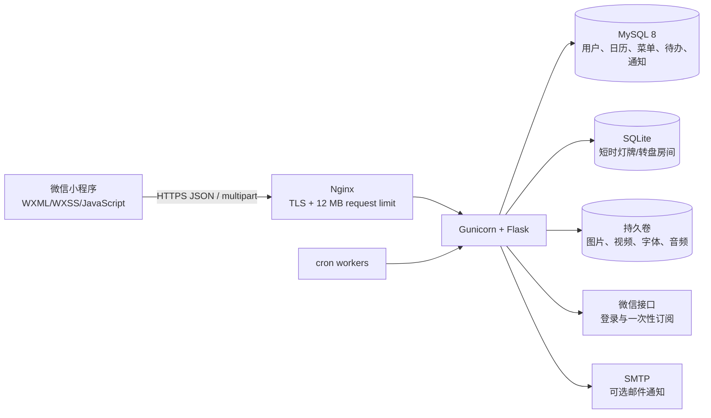

# 架构说明

## 边界

- 小程序只保存公开配置、短期会话 token 与本机草稿，绝不持有 AppSecret。
- Flask 是唯一业务信任边界；所有编辑接口重新校验会话、情侣空间和角色，不能只依赖前端隐藏按钮。
- MySQL 保存需要长期一致性的业务记录。
- 灯牌和情侣转盘房间是短时状态，SQLite 内含空闲/过期回收逻辑；高并发部署建议迁移到 Redis。
- 媒体默认写入 `/app/data` 持久卷；多机部署建议迁移到 S3/MinIO 并在上传模块统一生成 URL。

## API 前缀

统一前缀为 `/api/couple`。主要资源包括登录与情侣空间、日历、菜单/订单、待办、通知、上传、轮播图、问答、时间线、纪念日、灯牌房间、情侣转盘与媒体文件。

## 数据初始化

当前服务在首次访问相关模块时使用幂等 `CREATE TABLE IF NOT EXISTS`/增量字段检查初始化表结构，纪念日表在应用启动时初始化。生产演进到多人、多实例或频繁升级后，建议迁移到 Alembic，并在发布流水线中独立执行迁移。
